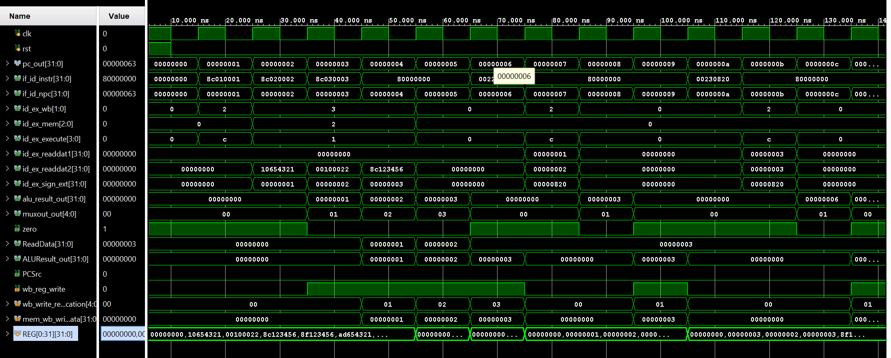
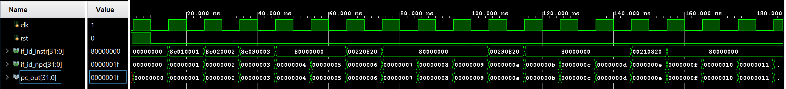
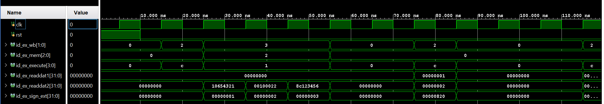
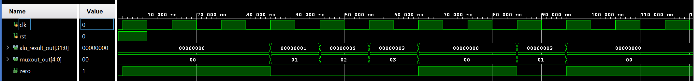
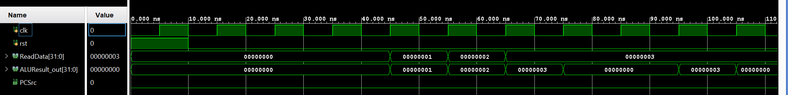
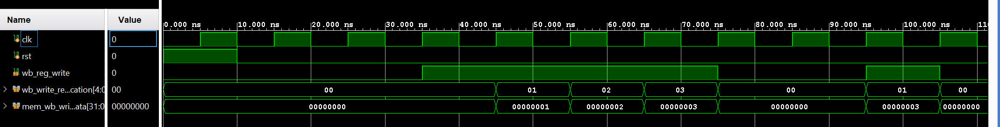

### Full 5-Stage MIPS Pipeline
---

#### Design Scope and Assumptions
* **In scope:** Structural integration and behavioral verification of a 32-bit, 5-stage pipelined MIPS processor (IF, ID, EX, MEM, WB) connected via `IF/ID`, `ID/EX`, `EX/MEM`, and `MEM/WB` pipeline latches.
* **Out of scope:** Hardware hazard detection, data forwarding, branch prediction, caches, exceptions/interrupts, and FPGA synthesis.
* **Assumptions:**
  * 32-bit datapath and 32-entry register file (`REG[0:31]`) with `$zero` (`REG[0]`) hardwired to `0`.
  * Word-addressed 256 × 32-bit instruction and data memories (`pc + 1`), initialized via `$readmemb` from `instr.txt` and `data.txt`.
  * 10 ns clock period (`5 ns` half-period) with active-high synchronous reset (`rst`).
  * Data hazards in the test program are avoided in software using `NOP` (`32'h80000000`, opcode `6'b100000`).
* **Limitations:** Supports `ADD`, `SUB`, `AND`, `OR`, `SLT`, `LW`, `SW`, and `BEQ`; back-to-back dependencies without software NOPs will read stale values.

---

#### Requirements
| ID | Requirement | Verification |
| ------ | ------ | ------ |
| REQ-01 | **IF:** Fetch instructions from `instrMem` (`instr.txt`), increment PC by 1, and select branch targets on `PCSrc`. | `FullMIPSPipelineTB.v` & `IMEM` console dump |
| REQ-02 | **ID:** Decode opcodes into WB/MEM/EX controls, sign-extend immediates, and support simultaneous reads/WB writes with `REG[0] = 0`. | Waveform inspection of `REG[0:31]` |
| REQ-03 | **EX:** Select ALU operands/destination register, execute ALU ops, compute branch targets, and latch into `EX/MEM` on `posedge clk`. | Verification of `ADD` results in `REG[1]` |
| REQ-04 | **MEM:** Read/write `data_memory` (`data.txt`), evaluate `PCSrc = Branch & Zero`, and latch into `MEM/WB` on `posedge clk`. | `LW` values loaded from `DMEM[1:3]` |
| REQ-05 | **WB:** Select `ReadData` vs. `ALUResult` via `MemtoReg` and write back to the ID register file. | Final register state (`REG[1:3]`) |

---

#### Architecture
```text
[IF: fetch] -> (IF/ID) -> [ID: decode] -> (ID/EX) -> [EX: execute] -> (EX/MEM) -> [MEM: MEMORY] -> (MEM/WB) -> [WB: wb_mux]
     ^                         ^                                                        |                           |
     |                         +---------------------(wb_reg_write, wb_write_data)------+---------------------------+
     +-----------------------------------------------(PCSrc, ex_mem_adder_out)----------+
```



---

#### Implementation
##### Source Code
| Stage | Files |
| ------ | ------ |
| **Top-Level** | [`FullMIPSPipeline.v`](https://github.com/ET-struct/Full-MIPS-Pipeline/blob/main/FullMIPSPipeline.v) |
| **IF** | [`fetch.v`](https://github.com/ET-struct/Full-MIPS-Pipeline/blob/main/IF-Stage/fetch.v), [`pc.v`](https://github.com/ET-struct/Full-MIPS-Pipeline/blob/main/IF-Stage/pc.v), [`mux.v`](https://github.com/ET-struct/Full-MIPS-Pipeline/blob/main/IF-Stage/mux.v), [`incrementer.v`](https://github.com/ET-struct/Full-MIPS-Pipeline/blob/main/IF-Stage/incrementer.v), [`instrMem.v`](https://github.com/ET-struct/Full-MIPS-Pipeline/blob/main/IF-Stage/instrMem.v), [`ifIdLatch.v`](https://github.com/ET-struct/Full-MIPS-Pipeline/blob/main/IF-Stage/ifIdLatch.v) |
| **ID** | [`decode.v`](https://github.com/ET-struct/Full-MIPS-Pipeline/blob/main/Decode-Stage/decode.v), [`control.v`](https://github.com/ET-struct/Full-MIPS-Pipeline/blob/main/Decode-Stage/control.v), [`regfile.v`](https://github.com/ET-struct/Full-MIPS-Pipeline/blob/main/Decode-Stage/regfile.v), [`signExtend.v`](https://github.com/ET-struct/Full-MIPS-Pipeline/blob/main/Decode-Stage/signExtend.v), [`idExLatch.v`](https://github.com/ET-struct/Full-MIPS-Pipeline/blob/main/Decode-Stage/idExLatch.v) |
| **EX** | [`execute.v`](https://github.com/ET-struct/Full-MIPS-Pipeline/blob/main/Execute-Stage/execute.v), [`adder.v`](https://github.com/ET-struct/Full-MIPS-Pipeline/blob/main/Execute-Stage/adder.v), [`alu.v`](https://github.com/ET-struct/Full-MIPS-Pipeline/blob/main/Execute-Stage/alu.v), [`alu_control.v`](https://github.com/ET-struct/Full-MIPS-Pipeline/blob/main/Execute-Stage/alu_control.v), [`top_mux.v`](https://github.com/ET-struct/Full-MIPS-Pipeline/blob/main/Execute-Stage/top_mux.v), [`bottom_mux.v`](https://github.com/ET-struct/Full-MIPS-Pipeline/blob/main/Execute-Stage/bottom_mux.v), [`ex_mem.v`](https://github.com/ET-struct/Full-MIPS-Pipeline/blob/main/Execute-Stage/ex_mem.v) |
| **MEM/WB** | [`MEMORY.v`](https://github.com/ET-struct/Full-MIPS-Pipeline/blob/main/Memory-and-Writeback-Stage/MEMORY.v), [`data_memory.v`](https://github.com/ET-struct/Full-MIPS-Pipeline/blob/main/Memory-and-Writeback-Stage/data_memory.v), [`mem_wb.v`](https://github.com/ET-struct/Full-MIPS-Pipeline/blob/main/Memory-and-Writeback-Stage/mem_wb.v), [`AND.v`](https://github.com/ET-struct/Full-MIPS-Pipeline/blob/main/Memory-and-Writeback-Stage/AND.v), [`wb_mux.v`](https://github.com/ET-struct/Full-MIPS-Pipeline/blob/main/Memory-and-Writeback-Stage/wb_mux.v) |
| **Test / Init** | [`FullMIPSPipelineTB.v`](https://github.com/ET-struct/Full-MIPS-Pipeline/blob/main/FullMIPSPipelineTB.v), [`instr.mem`](https://github.com/ET-struct/Full-MIPS-Pipeline/blob/main/instr.mem), [`data.mem`](https://github.com/ET-struct/Full-MIPS-Pipeline/blob/main/data.mem) |

##### Key Integration Fixes
* **Control Encoding:** Packed in `control.v` as `ex = {RegDst, ALUOp[1:0], ALUSrc}`, `mem = {Branch, MemRead, MemWrite}`, and `wb = {RegWrite, MemtoReg}`.
* **Timing Alignment:** Converted `control.v` and `regfile.v` reads to combinational `always @(*)` (avoiding a 1-cycle lag before `idExLatch`) and updated `ex_mem.v` from `always @*` to synchronous `always @(posedge clk)`.
* **Register & Memory Fixes:** Hardwired `REG[0] = 0`, separated synchronous writes from combinational reads in `regfile.v`, changed `data_memory.v` from `always @(addr)` to `always @(*)`, and pre-filled `instrMem.v` with `32'h80000000` (NOP) before `$readmemb`.

---

#### Verification
Verified via behavioral simulation in **Xilinx Vivado 2022.2 (`xsim`)** using [`FullMIPSPipelineTB.v`](FullMIPSPipelineTB.v).
# Full MIPS Pipeline 

# Instruction Fetch Stage

# Decode Stage 

# Execute Stage

# Memory Stage

# Writeback Stage 


| Test Case | Operation | Expected | Observed | Status |
| ------ | ------ | ------ | ------ | ------ |
| TC-01 — Init & `$zero` | `rst = 1 → 0`, memory load | `REG[0] = 0x00000000`; clean `IMEM`/`DMEM` load | `REG[0] = 00000000`; no `X` values | Pass |
| TC-02 — Loads (`LW`) | `lw $1, 1($0)`, `lw $2, 2($0)`, `lw $3, 3($0)` | `REG[1]=1`, `REG[2]=2`, `REG[3]=3` | `REG[1:3]` updated to `1`, `2`, `3` | Pass |
| TC-03 — R-Type (`ADD`) | `add $1,$1,$2` → `+$3` → `+$1` → `+$0` | `REG[1]`: `1 → 3 → 6 → 0x0000000C` | `REG[1] = 0000000c` | Pass |
| TC-04 — NOP Drain | Trailing `32'h80000000` NOPs | `REG[4:9]` unchanged; `REG[10:31] = 0` | No unintended writes through `1010 ns` | Pass |

---

#### Reproduction Instructions (Vivado 2022.2)
1. Create an RTL project and add `FullMIPSPipeline.v` plus all stage `.v` files as **Design Sources**.
2. Add `FullMIPSPipelineTB.v` as a **Simulation Source** and set it as Top.
3. Add `instr.txt` (with no header text on line 1) and `data.txt` as Simulation Sources (filter: **All Files (`*.*`)**, check **Copy sources into project**), or place them in `<project>.sim/sim_1/behav/xsim/`.
4. Run **Behavioral Simulation**, add `uut → d1 → rf0 → REG[0:31]` to the waveform, restart, and run for `1010 ns`.

Expected Tcl Console output:
```text
	IMEM[0] = 10001100000000010000000000000001
	IMEM[1] = 10001100000000100000000000000010
	IMEM[2] = 10001100000000110000000000000011
	IMEM[3] = 10000000000000000000000000000000
	IMEM[4] = 10000000000000000000000000000000
	IMEM[5] = 1000100000100000100000
	IMEM[6] = 10000000000000000000000000000000
	IMEM[7] = 10000000000000000000000000000000
	IMEM[8] = 10000000000000000000000000000000
	IMEM[9] = 1000110000100000100000
	IMEM[10] = 10000000000000000000000000000000
	IMEM[11] = 10000000000000000000000000000000
	IMEM[12] = 10000000000000000000000000000000
	IMEM[13] = 1000010000100000100000
	IMEM[14] = 10000000000000000000000000000000
	IMEM[15] = 10000000000000000000000000000000
	IMEM[16] = 10000000000000000000000000000000
	IMEM[17] = 10000000000000000000000000000000
	IMEM[18] = 1000000000100000100000
	IMEM[19] = 10000000000000000000000000000000
	IMEM[20] = 10000000000000000000000000000000
	IMEM[21] = 10000000000000000000000000000000
	IMEM[22] = 10000000000000000000000000000000
	IMEM[23] = 10000000000000000000000000000000
	DMEM[0] = 0
	DMEM[1] = 1
	DMEM[2] = 10
	DMEM[3] = 11
	DMEM[4] = 100
	DMEM[5] = 101
```

---

#### Repository Organization
```text
.
├── README.md
├── FullMIPSPipeline.v
├── FullMIPSPipelineTB.v
├── instr.txt
├── data.txt
├── images/
│   ├── DecodeStage.png
│   ├── ExecuteStage.png
│   ├── FullMIPSPipeline.png
│   ├── IFstage.png
│   ├── MemoryStage.png
│   └── WBStage.png
├── IF-Stage/
│   ├── fetch.v
│   ├── pc.v
│   ├── mux.v
│   ├── incrementer.v
│   ├── instrMem.v
│   └── ifIdLatch.v
├── Decode-Stage/
│   ├── decode.v
│   ├── control.v
│   ├── regfile.v
│   ├── signExtend.v
│   └── idExLatch.v
├── Execute-Stage/
│   ├── execute.v
│   ├── adder.v
│   ├── alu.v
│   ├── alu_control.v
│   ├── top_mux.v
│   ├── bottom_mux.v
│   └── ex_mem.v
└── Memory-Writeback-Stage/
    ├── MEMORY.v
    ├── data_memory.v
    ├── mem_wb.v
    ├── AND.v
    └── wb_mux.v
```

---

#### Known Issues and Future Improvements
* **Word vs. Byte Addressing:** Uses word-addressed increments (`+1`) and omits a shift-left-2 before the branch adder to match `instr.txt`/`data.txt`. Standard byte addressing requires `+4`, a shift-left-2 unit, and `addr[9:2]` memory indexing.
* **Software-Only Hazard Handling:** Dependent instructions currently require manual NOPs, and branches do not flush fetched instructions.
* **Future Work:** Add a Data Forwarding (Bypass) Unit in EX, a Load-Use Hazard Detection Unit with pipeline stall/flush logic, and expand ISA support (`ADDI`, `ANDI`, `ORI`, `SLL`, `SRL`, `J`).
